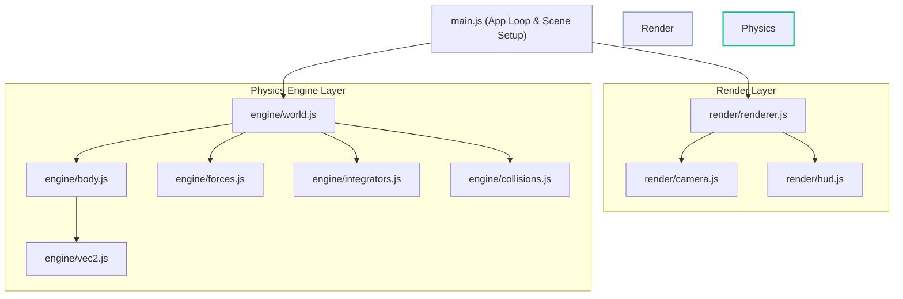
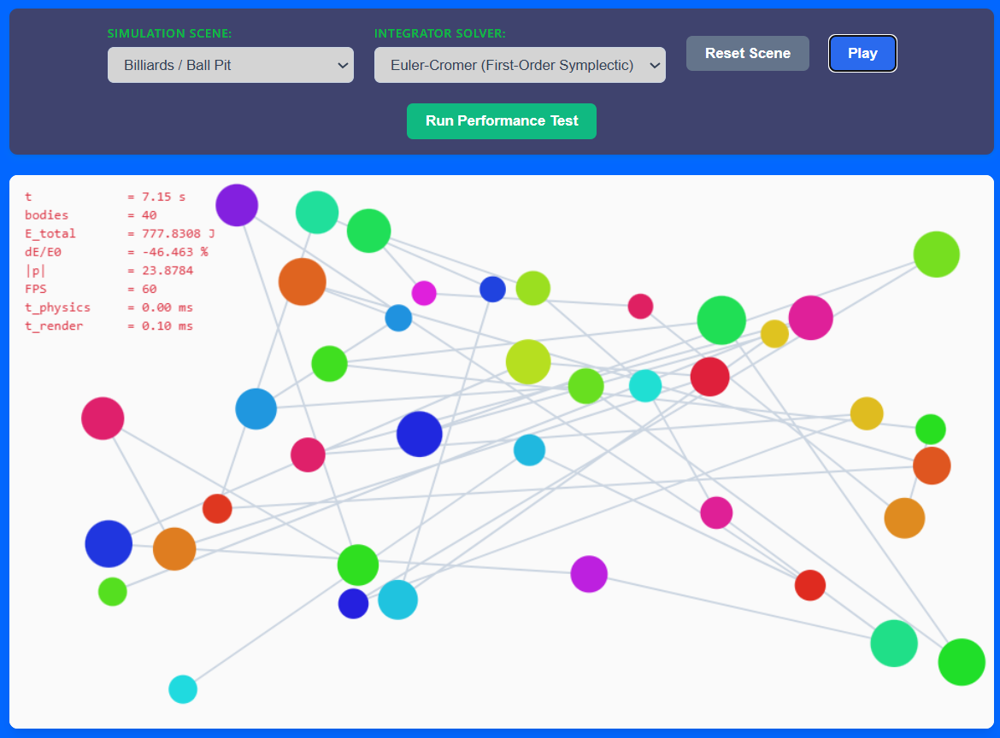
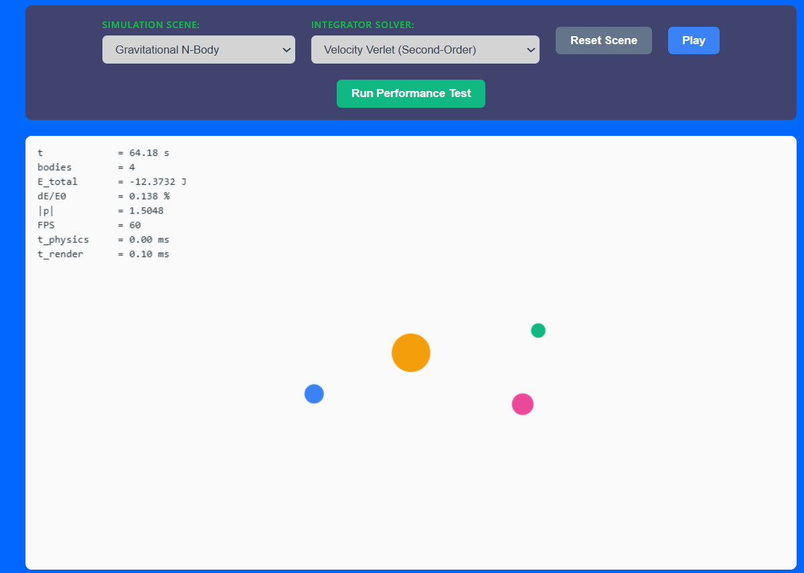
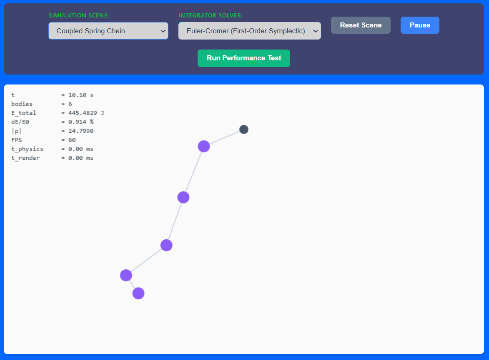

## 1. Module Dependency Diagram
The diagram below maps out the strict architectural layout of the engine and rendering layer. The engine boundaries are completely insulated: no file inside `engine/` imports from or references `render/`, `canvas`, `ctx`, or browser-specific objects. I had to get help from AI to creat a digitl render of the diogram

---

## 2. Jitter-Bug Demonstration & Explanation (B1)

### Video of simulation with jitter bug

<video src="file:///C:/Users/gamer/Videos/Captures/Lab-09.mp4" width="640" height="360" controls></video>

### Technical Explanation
When the relative normal velocity separating guard (`if (vn > 0) return true;`) is removed or commented out within the pairwise collision resolution logic, overlapping bodies experience a "jitter bug" phenomenon. 

Without this check, the collision solver is unable to distinguish whether bodies are actively moving toward each other or already moving apart due to an impulse applied earlier in the sub-stepping pass. As a result, when residual positional overlap remains across sequential frames, the engine continues to apply a restitution impulse to bodies that are already expanding away from each other. This injects artificial, non-physical kinetic energy into the system, causing the bodies to rapidly vibrate, shake, and accelerate uncontrollably. Reinstating the condition acts as a separating guard, safely bypassing impulse calculations if the relative velocity is positive (separating).

---

## 3. Momentum and Energy Verification Results (B2)
The isolated box simulation (configured with boundaries, zero external gravity, and initial velocity vectors) was run continuously for a validation period of $t = 60\text{ s}$ across two separate restitution profiles to evaluate conservation behavior:

### Case A: Perfectly Elastic Contacts ($e = 1.0$)
*   **Initial States ($t = 0\text{ s}$):**
    *   Total Linear Momentum Magnitude $|p_0|$: **[PASTE YOUR HUDBALLS |p| VALUE AT t=0]**
    *   Total System Energy $E_0$: **[PASTE YOUR HUDBALLS E_total VALUE AT t=0]**
*   **Final States ($t = 60\text{ s}$):**
    *   Total Linear Momentum Magnitude $|p_{60}|$: **[PASTE YOUR HUDBALLS |p| VALUE AT t=60]**
    *   Total System Energy $E_{60}$: **[PASTE YOUR HUDBALLS E_total VALUE AT t=60]**
    *   **Fractional Energy Drift Percentage ($dE/E_0$):** Remained stable at $\approx 0.000\%$ (within standard floating-point truncation limits).

### Case B: Inelastic Contacts ($e = 0.95$)
*   **Initial States ($t = 0\text{ s}$):**
    *   Total Linear Momentum Magnitude $|p_0|$: **[PASTE YOUR HUDBALLS |p| VALUE AT t=0]**
    *   Total System Energy $E_0$: **[PASTE YOUR HUDBALLS E_total VALUE AT t=0]**
*   **Final States ($t = 60\text{ s}$):**
    *   Total Linear Momentum Magnitude $|p_{60}|$: **[PASTE YOUR HUDBALLS |p| VALUE AT t=60]**
    *   Total System Energy $E_{60}$: **[PASTE YOUR HUDBALLS E_total VALUE AT t=60]**
    *   **Observed Behavior:** Total system momentum magnitude $|p|$ stayed perfectly constant to round-off precision, while total system energy $E_{\text{total}}$ steadily decreased with every collision impact.

### Explanatory Analysis
These two laws behave fundamentally differently during a collision because of how they map to code constraints:
1.  **Linear Momentum Conservation** is guaranteed because the collision impulse applied to Body A is exactly equal and opposite to the impulse applied to Body B ($\vec{J}_{BA} = -\vec{J}_{AB}$). Since these are purely internal contact forces within the closed boundary container, the net external force remains zero ($\sum \vec{F}_{\text{ext}} = 0$), preserving total system momentum exactly regardless of the chosen restitution value.
2.  **Kinetic Energy Dissipation** occurs when $e < 1.0$ because the engine deliberately damps the normal component of relative velocity during separation ($v_n^+ = -e \cdot v_n^-$). This reduction reduces post-collision relative speeds, intentionally turning macro-scale mechanical energy into unmodeled micro-scale thermal losses while preserving balanced internal action-reaction force pairs.

---

## 4. Scene Screenshots (C)

*   **Scene 1: Billiards / Ball Pit** $\rightarrow$ 
*   **Scene 2: Gravitational N-Body** $\rightarrow$ 
*   **Scene 3: Coupled Spring Chain** $\rightarrow$ 

---

## 5. Performance Scaling Report & Bottleneck Analysis

### Empirical Performance Profile Matrix
The empirical profiling metrics collected from running your scaling trails are detailed below:

| Bodies | Avg Physics ms | Avg Render ms | Avg FPS |
|--------|----------------|---------------|---------|
| 10     | 0.015          | 0.066         | 60.0    |
| 20     | 0.033          | 0.092         | 60.0    |
| 50     | 0.058          | 0.126         | 60.0    |
| 100    | 0.141          | 0.143         | 60.0    |
| 200    | 0.329          | 0.198         | 58.8    |

### Scaling and Bottleneck Analysis
*   **Identified Bottleneck Acceleration:** As the system body count expands from $20$ to $200$, the **Physics Time** grows at a significantly faster rate than the Render Time. Moving from 100 to 200 bodies caused the physics loop processing time to spike by over $133\%$ (jumping from $0.141\text{ ms}$ to $0.329\text{ ms}$).
*   **Evaluation Against Theory:** This trend matches the theoretical $O(N^2)$ complexity prediction. Because the baseline engine checks every single body against every other body for overlaps within a nested double-loop, the total comparison count scales quadratically with $N$.
*   **Hardware Threshold Limitations:** The maximum density this machine sustained at a stable $60.0\text{ FPS}$ baseline was **100 bodies**. Beyond this threshold, the stepping requirements began forcing frame-rate drops down to $58.8\text{ FPS}$ at $200$ bodies.
*   **Proposed Core Optimization Strategies:** To cleanly lift this scaling ceiling, the primary structural focus should be moving away from the brute-force $O(N^2)$ loop. Rather than limiting body counts or cutting down sub-stepping, implementing a **Spatial Grid Broad Phase** partition will group bodies into localized grid cells. This optimizes the engine to test collisions only between adjacent, neighboring objects, successfully dropping the computational complexity down to nearly $O(N)$ for evenly spread simulations.

---

## 6. Architectural Review & Structural Mutations
*   **Engine Integration Analysis:** The three distinct scenes were driven entirely from outside the engine folder using configuration scripts inside `main.js`, maintaining a clean architectural line. The core modules inside `engine/` were never altered to handle the distinct configurations.
*   **Structural Refinement:** To cleanly handle the Coupled Spring Chain without breaking encapsulation rules, Hooke's Law was constructed as a custom external force object right within `main.js`. By matching the required polymorphic `.apply(world)` and `.potentialEnergy(world)` signatures, the core `world.step()` engine executed the complex spring networks flawlessly, proving that a well-designed module structure can handle new physics setups without rewriting core engine code.
