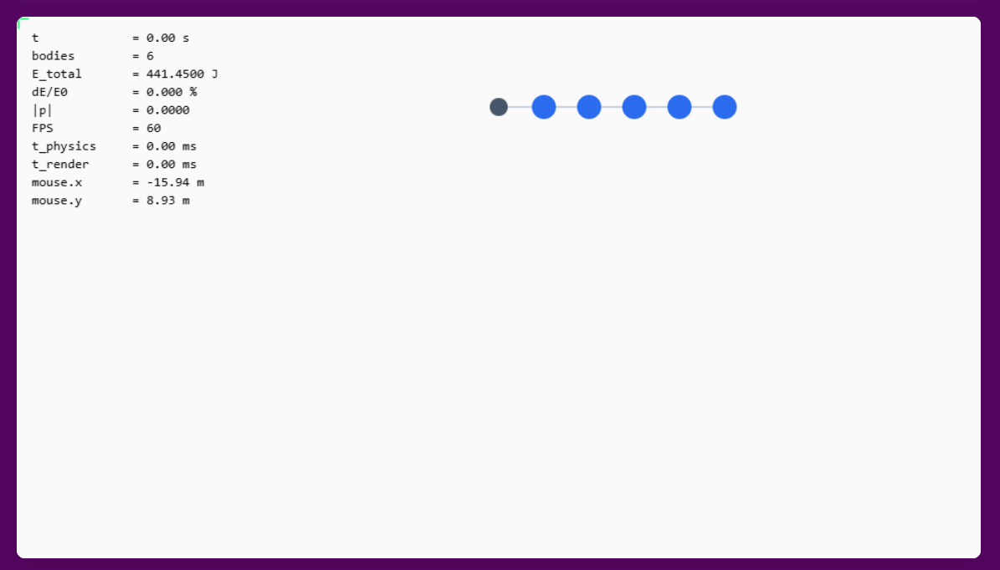
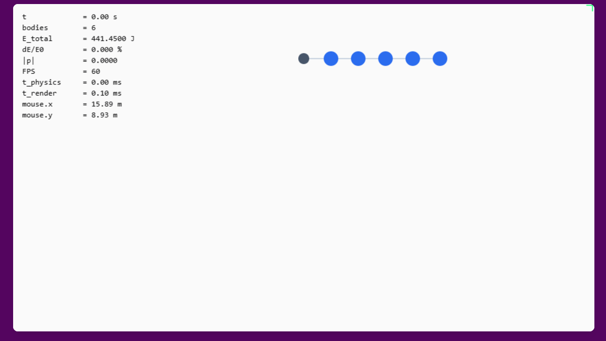
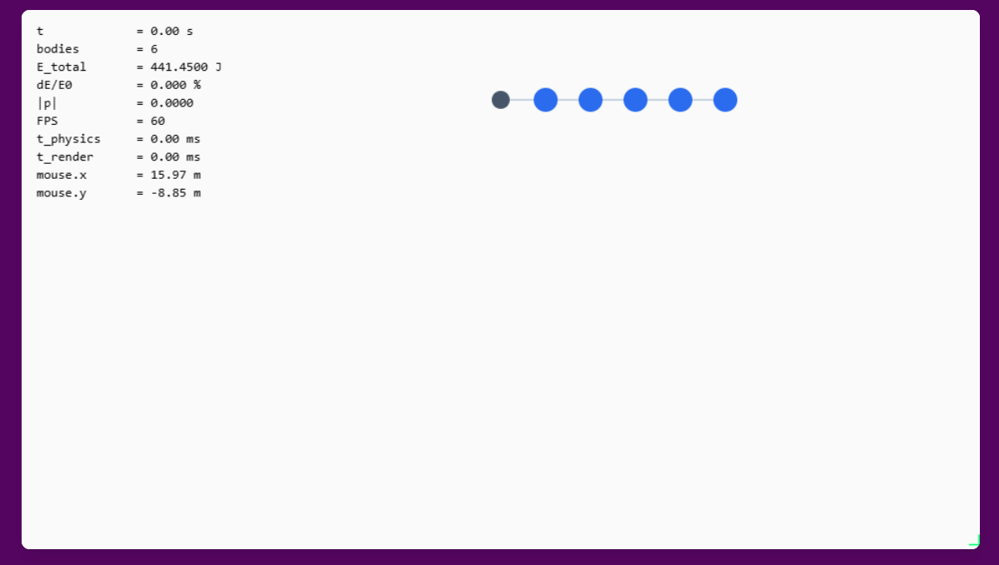
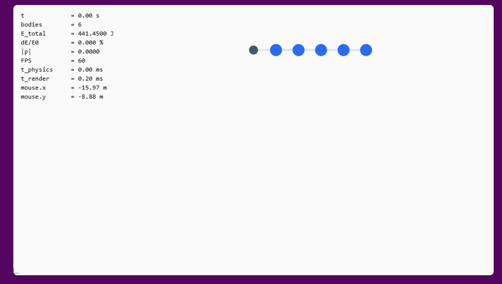
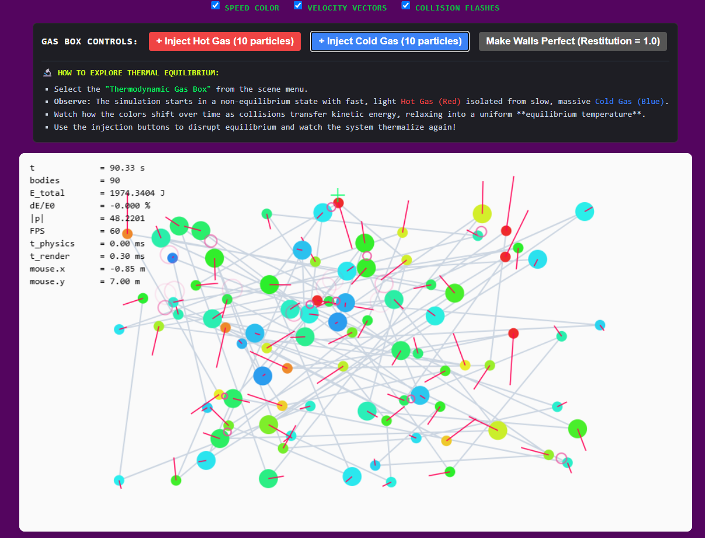

**Part A**

for section *A1* here aare the screen shots of the 4 corners with the cordinats on the hud. The loctaion is not exact due to the rounded edges of my display.

*Part A3*

The slider for the central mass was caped at 2000 due to the fact, as is talked about in the lesson, the time scale of the movement of any given object must be much smaller then the time step.  With a sufficiently high mass the speed of the “planets” would exceed the 1/120 frame rate that is chose for my simulation. 

**Part B**

*Part B1*
The problems with teleporting the object are many. First off when you teleport the object it douse not gain the new force of being dragged, this means that once teleported it will either forget its velocity vector or go flying off in an arbitrary direction. The biggest problem that I observed is collisions, especially with the small objects, due to the fact that an object can be teleported inside of another this makes the code very upset and the simulation kind of explodes. 

*B2* 
My three visuals are speed color, velocity vectors, and collision flashes. These each tell something different about the object : the speed color being red for high speed and blue for low, show at a glance the average speed ; the velocity vectors allow for the direction and magnitude of that speed to be visualized; the collision flashes indicate when contact has been made between two objects. 

*B3*

The world of my simulation was viewable from my phone when I launched the website, in addition on my phone all the buttons being labeled made it ease to work the simulation. 
Uu plugging my mouse did not make it much harder to operate the simulation, with key strokes I was able to do all the functions and it was actually easer to use the sliders with arrow keys than with a mouse. 

**Part C**
I wanted to simulate a box of gas with its contents up to the users to show how different starting conditions would affect the overall equilibrium temperature. This is achieved with the addition of small hot particles and large cold particles. 

For my simulation I address the conservation of momentum showing how slow moving massive particles and fast moving light particles interact. I also show the conservation of mechanical energy of a system by the average color ( temperature ) of the particles. 

*Validation*
Setting the restitution to 1 to prevent energy loss to enviroment, the drift in energy after 90 seconds was found to be 0% 
