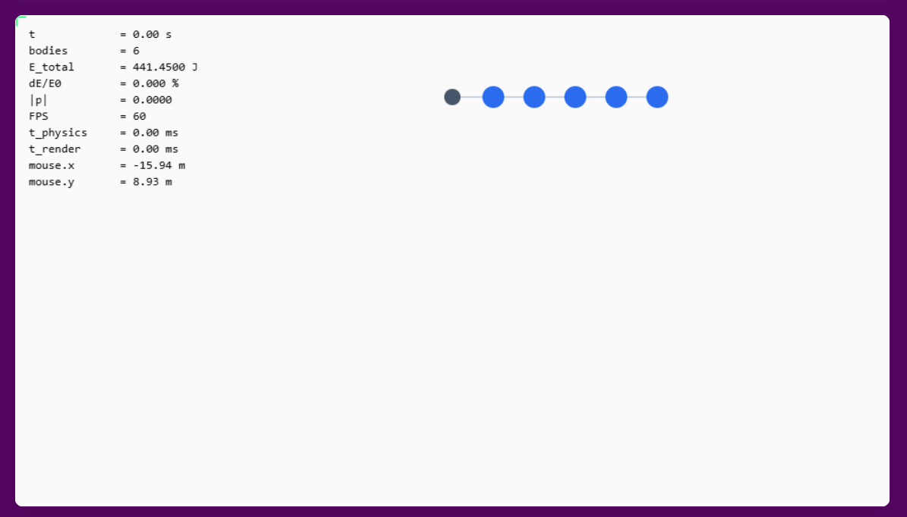
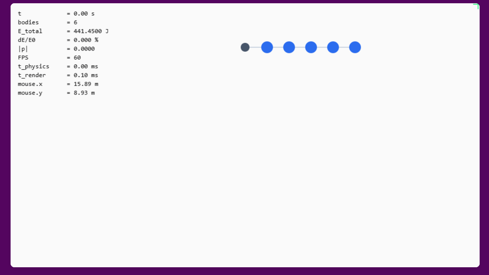
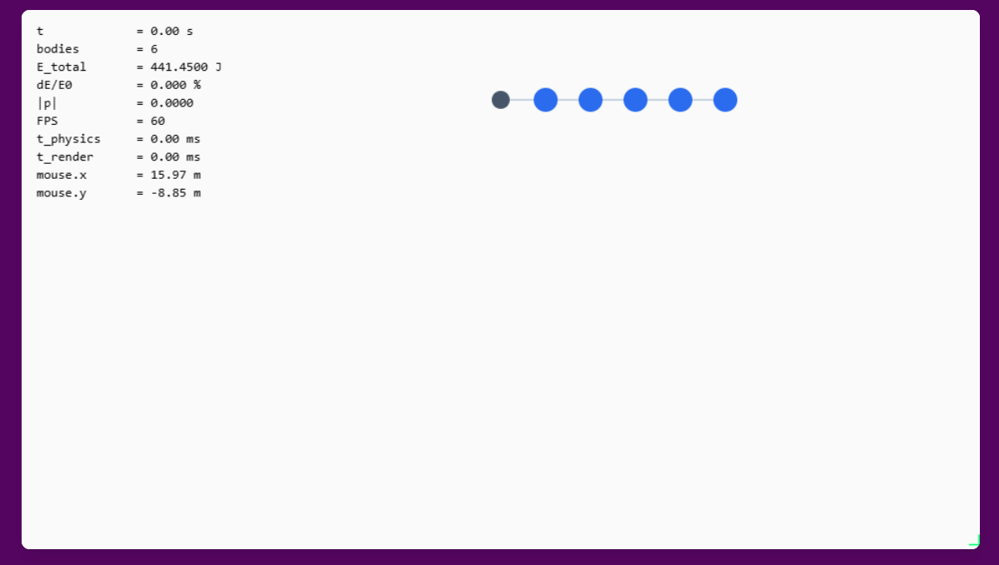
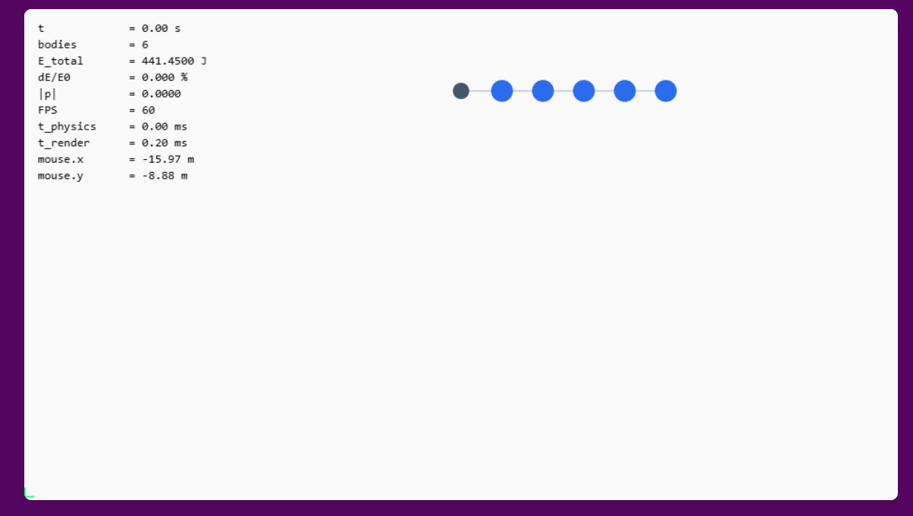

**Part A**

for section *A1* here aare the screen shots of the 4 corners with the cordinats on the hud. The loctaion is not exact due to the rounded edges of my display.

*Part A3*

The slider for the central mass was caped at 2000 due to the fact, as is talked about in the lesson, the time scale of the movement of any given object must be much smaller then the time step.  With a sufficiently high mass the speed of the “planets” would exceed the 1/120 frame rate that is chose for my simulation. 

**Part B**

*Part B1*
The problems with teleporting the object are many. First off when you teleport the object it douse not gain the new force of being dragged, this means that once teleported it will either forget its velocity vector or go flying off in an arbitrary direction. The biggest problem that I observed is collisions, especially with the small objects, due to the fact that an object can be teleported inside of another this makes the code very upset and the simulation kind of explodes. 